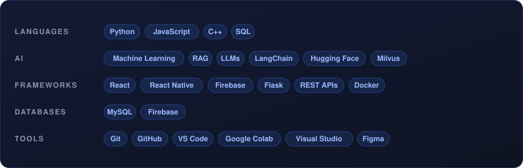
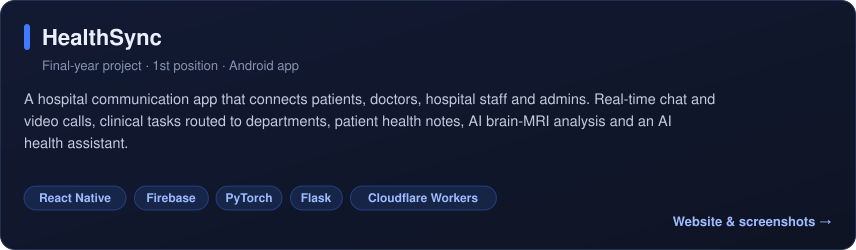
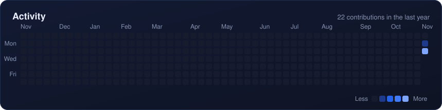

 

## About me

- 🎓 **BS Computer Science**, Sir Syed CASE Institute of Technology, Islamabad (2021–2025). My final-year project **HealthSync** won **1st position**.
- 💼 **AI Application Developer**, client project (May 2026 – present)
- 🧠 **AI Engineer Intern** at C@re, Center of Advanced Research in Engineering (Sep – Dec 2025): built a RAG system for question answering over large document collections
- 🩻 **Machine Learning Intern** at NESCOM (Aug – Oct 2024): deep learning for MRI image restoration
- 🌐 **Frontend Developer Intern** at Codsoft (Aug – Sep 2023)
- ✨ I enjoy building **AI-powered apps**: RAG and LLM systems, and **mobile apps** with React Native

## Toolbox

## Featured projects

     

🌐 HealthSync website: <a href="https://hassaan2077.github.io/HealthSync-Showcase/">hassaan2077.github.io/HealthSync-Showcase</a>

## Activity

